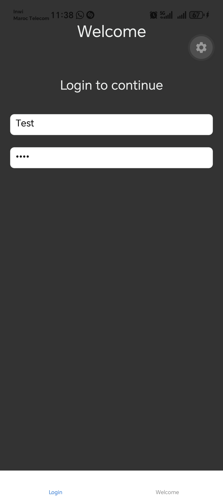
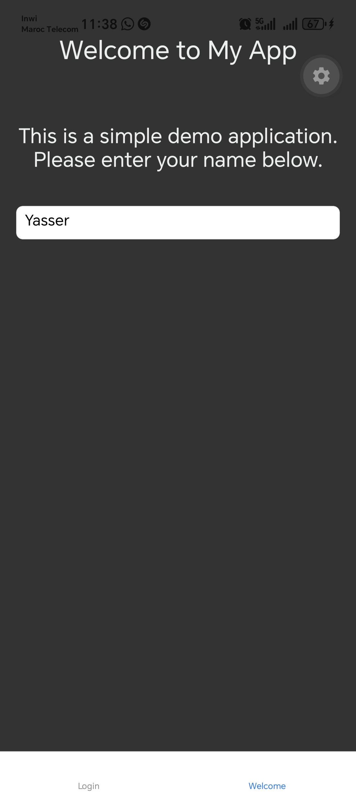

# Lab 10 — Navigation par onglets en bas de l’écran

L’onglet **Login** affiche les champs e-mail et mot de passe. Les caractères du mot de passe sont masqués.

L’onglet **Welcome** affiche l’écran d’accueil et son champ de saisie du prénom. Les deux onglets restent visibles en bas.

